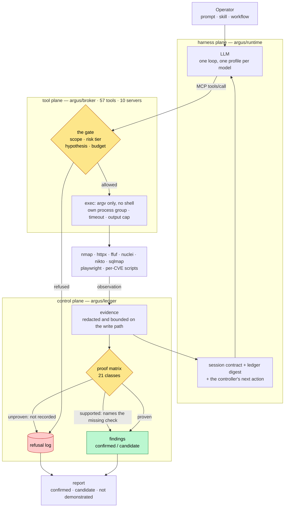
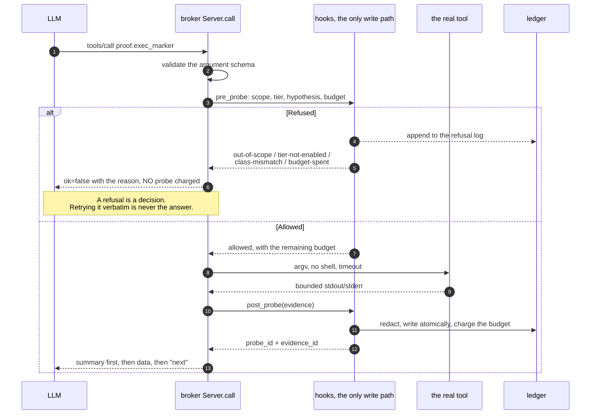
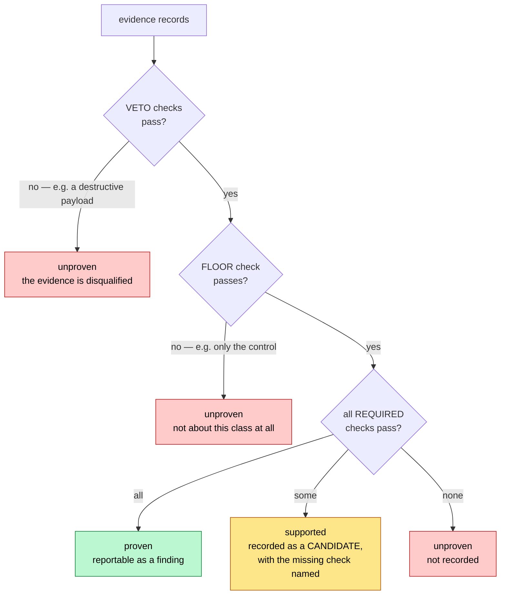
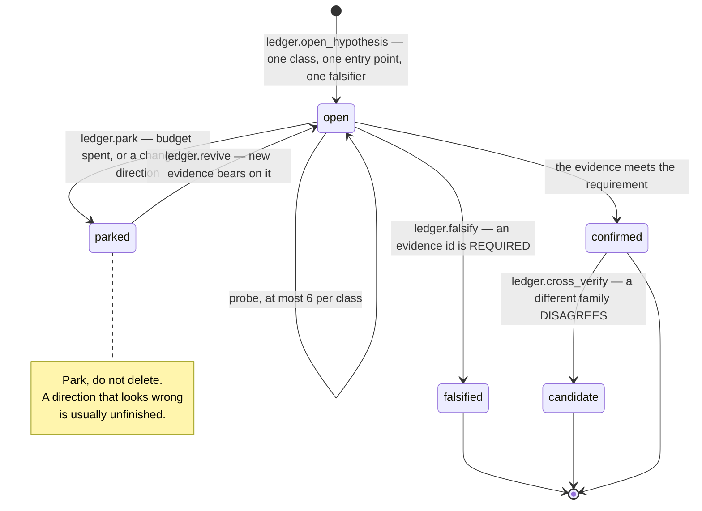
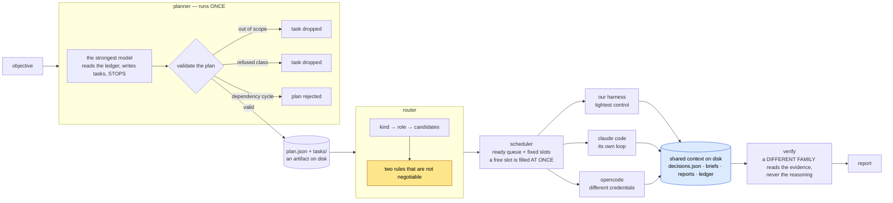
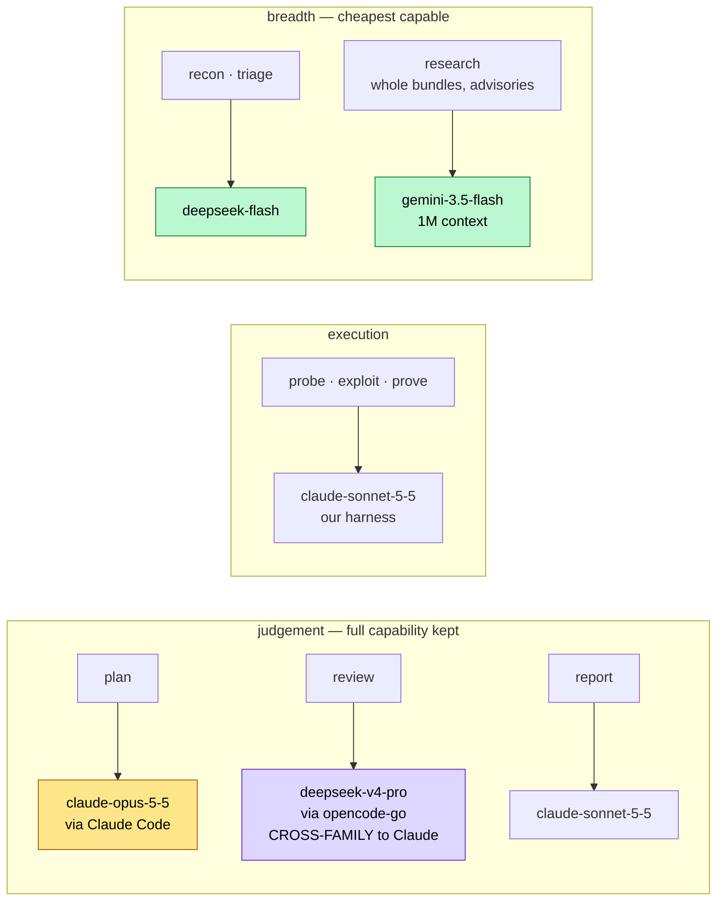
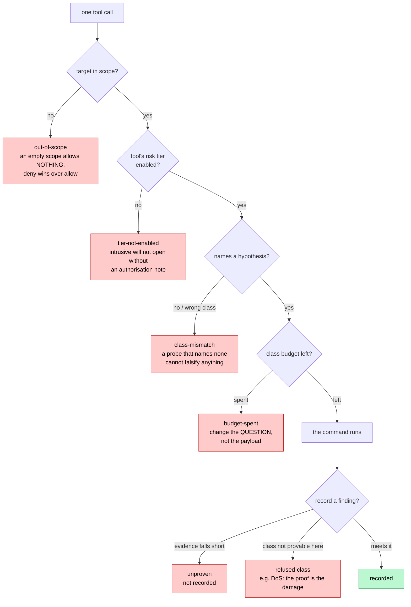
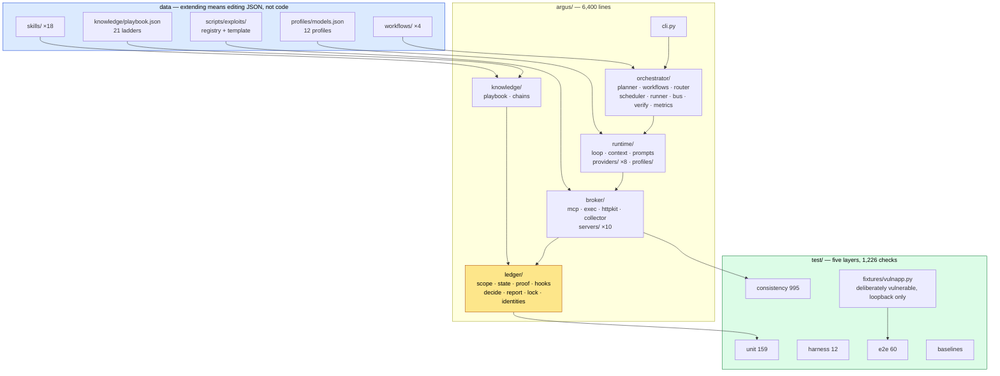

# Diagrams

Mermaid, so GitHub renders them in the browser. `ARCHITECTURE.md` carries the
same structure as ASCII, which works in a terminal where this file does not.
A Vietnamese edition with fuller commentary is at `docs/vi/SO-DO.md`.

Each diagram is followed by the thing a diagram cannot show: why an arrow is
there, or the failure it prevents.

---

## 1. The four planes, and one path through them



The arrow that matters most is `EV --> CTX`. The model's next decision is
computed from the ledger on disk rather than from its own summary of what
happened, which is why a run can be interrupted and resumed by a **different
model** with the engagement still exactly where it was.

---

## 2. One command through the gate



Two things the diagram does not say. `summary` comes first because a model reads
the first lines of a tool result far more reliably than the last. And a refusal
charges no probe: a refusal is not an observation, and charging one punishes the
model for asking correctly.

---

## 3. How a grade is decided



| Mechanism | The measured failure behind it |
|---|---|
| **veto** | "proof command stayed benign" passes trivially when no command ran. As a *required* check it made any record whatsoever under an `rce` hypothesis recordable as a critical candidate. |
| **floor** | A record set carrying only its control graded `supported`: "every redirect destination stayed in origin" came back as partial progress toward an open redirect. |
| **required** | `rce` needs a declared command, the nonce in the **output**, and an identity line. Before the fix, a parameter that merely reflected the probe's token satisfied "the nonce was echoed" and the class graded `proven` with nothing executed — reproduced end to end, twice, independently. |

---

## 4. A hypothesis, from open to closed



A spent budget changes strategy rather than ending the engagement: reuse a known
chain, reclassify the surface, research the stack, widen the surface, fan out a
fleet, hand off to a human. `report` fires only when every rung is spent.

---

## 5. The orchestrator



The two rules: review is cross-family, because two models that agree from a
shared prior are not a check; and breadth goes to the cheapest capable model
while judgement does not, because a plan written by the cheapest model is a false
economy — it is the one artifact the whole engagement is shaped by.

What is absent: nothing here understands the whole engagement. A plan on disk, a
decisions store any agent can read, and a ledger every tool call writes to, so an
agent joining at task nine knows what the first eight established.

---

## 6. What this machine actually routes to

Measured with `argus fleet` under the default `balanced` policy.



The `strengths` fields in `argus/runtime/profiles/models.json` are **routing
hypotheses, not measurements**. Correcting one is a JSON edit, and `argus metrics`
is how a measurement would contradict it.

---

## 7. The six refusals



All six go to `log/refusals.jsonl`, which is what lets `argus metrics` answer
"how many times did this agent try to act outside what it was allowed to do" —
the number claim 3 in `ARCHITECTURE.md` section 6 is about.

---

## 8. The measured live run

`deepseek-v4-pro` through `opencode-go`, driven by our harness against the
loopback fixture. Task: prove or kill command injection in the `host` parameter
of `/ping`.

```mermaid
sequenceDiagram
    autonumber
    participant M as deepseek-v4-pro
    participant L as ledger
    participant K as proof matrix
    participant T as target (fixture)

    M->>L: ledger.open_hypothesis (rce)
    L-->>M: hy-38453b6a67 open
    M->>K: proof.requirement (rce)
    K-->>M: declared command + nonce in output + identity line
    Note over M,K: It read the requirement BEFORE probing.<br/>Exactly the discipline the contract asks for.
    M->>T: http.probe (baseline)
    T-->>M: 200, 29 bytes
    M->>T: proof.exec_marker (id; echo nonce)
    T-->>M: nonce returned, uid=1000(kali)
    M->>K: grade
    K-->>M: proven
    M->>L: ledger.record_finding
    L-->>M: fi-18417e082e — confirmed
    M->>L: ledger.read_evidence
    L-->>M: 2 records — it re-read its own work
```

| Measurement | Value |
|---|---|
| probes spent | 2 |
| refusals | 0 |
| findings | 1, graded `proven` |
| tokens | 54,083 |
| cost | $0.017 |
| wall clock | 777s — **129s per step** |

129 seconds per step is the number worth keeping: it is the price of a stateless
CLI backend, which re-sends the whole prompt and pays a process start every step.
The key-based HTTP adapters would not, and they still have no live run behind
them.

---

## 9. The repository, as components



Four extension points, and three of them are data files: a vulnerability class, a
probe ladder, a per-CVE script, a model profile. Only adding an MCP tool takes
code, and that is one decorated function.
`skills/extending-argus/SKILL.md` holds the contract for all four.

---

## 10. What these diagrams do not show

- **Three of the five research claims need live models and have not been run.**
  `ARCHITECTURE.md` section 6 names each with the baseline it needs.
- **The offline half exists**, and its subject is a scripted driver rather than a
  model: it measures what the *gate* does to a given sequence of actions. The
  ungated write path admitted 4 findings whose evidence meets no part of its
  class requirement; the gated path admitted 0 — and `test/baselines.py` says
  that is a property of the gate, not a discovery about models.
- **No run has reused a chain card on a second target**, so "the second run
  against a stack is cheaper" is a design claim.
- **Seven classes have no depth skill**, named in `skills/INDEX.md`.
- **The fixture is a fixture, not a benchmark**: exact ground truth, and no
  evidence about generalisation.
