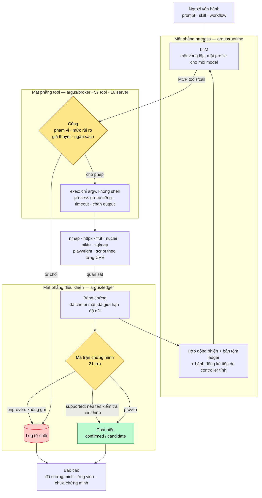
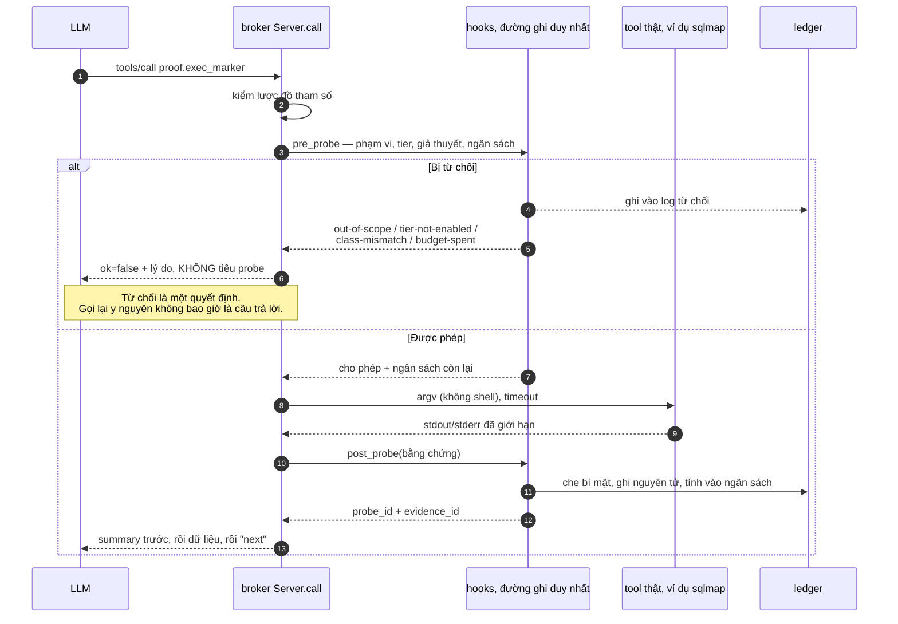
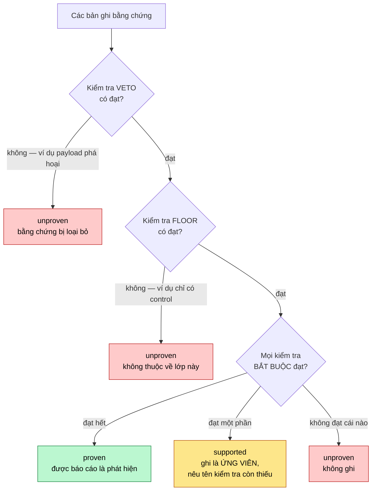
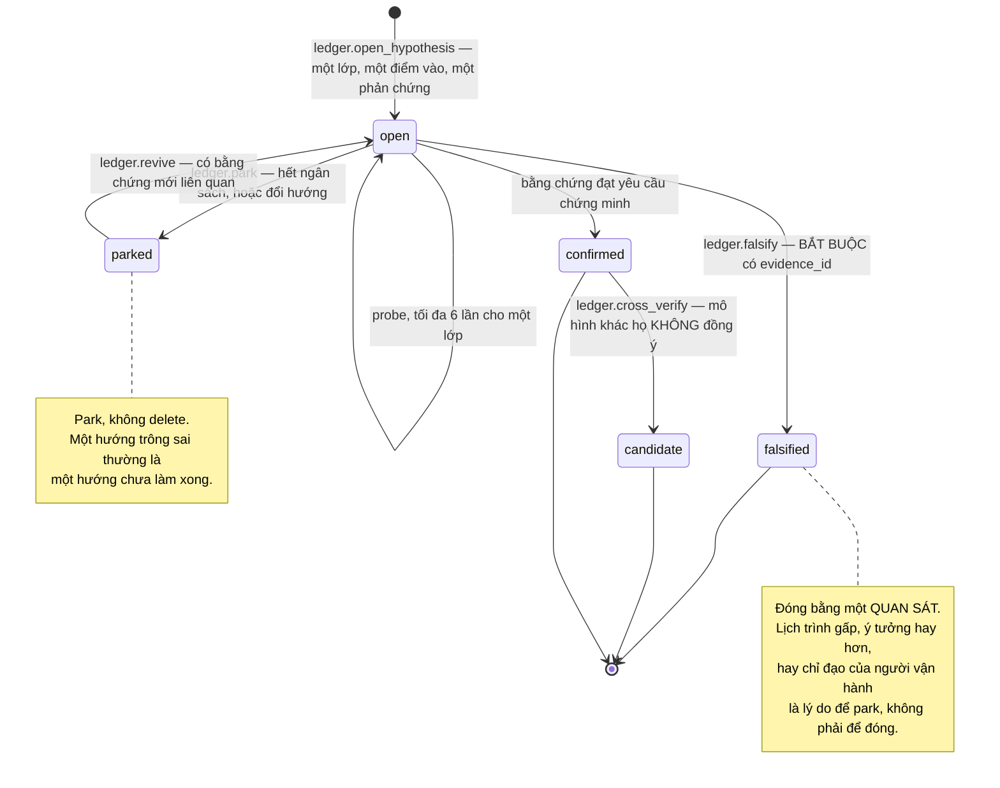
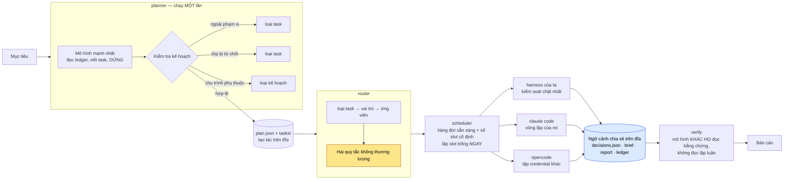
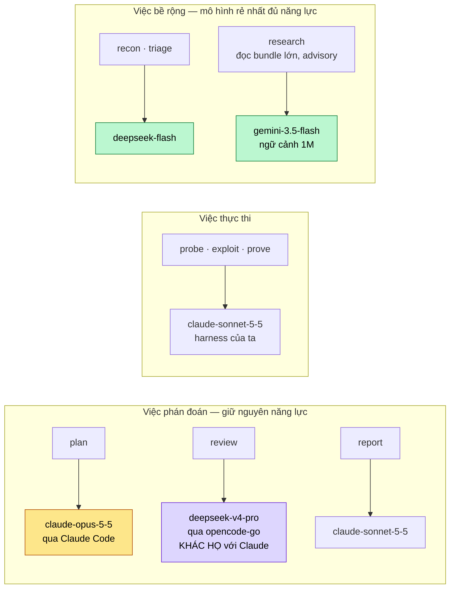
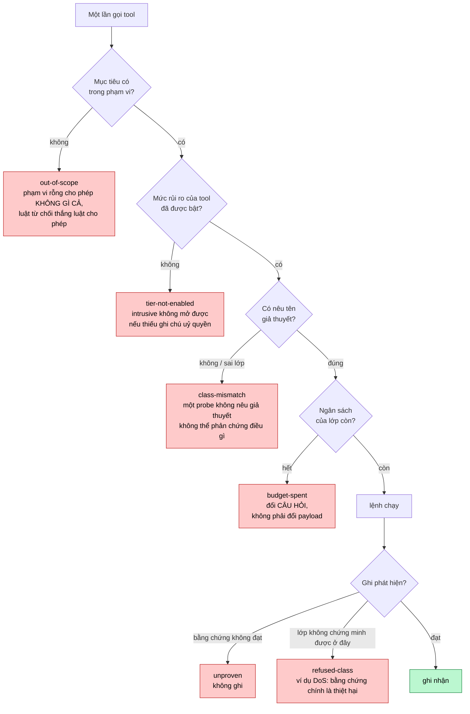
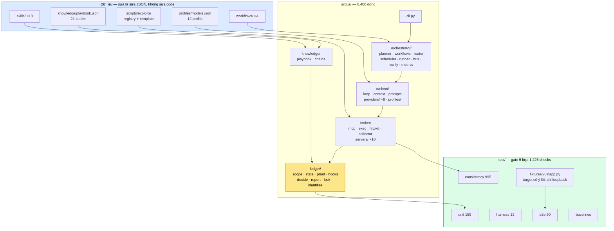

# argus — Sơ đồ hệ thống

Các sơ đồ dưới đây viết bằng Mermaid, GitHub tự dựng hình khi mở file này. Bản
tiếng Anh cùng bộ sơ đồ nằm ở `docs/DIAGRAMS.md`; mô tả kiến trúc đầy đủ ở
`ARCHITECTURE.md`, và bản mô tả tiếng Việt ở `docs/vi/TONG-QUAN.md`.

Mỗi sơ đồ kèm một đoạn giải thích **điều mà sơ đồ không vẽ được**: lý do một mũi
tên tồn tại, hoặc thất bại mà nó ngăn.

---

## 1. Toàn cảnh: bốn mặt phẳng và một đường đi

Đúng theo sơ đồ `người dùng → LLM → MCP → tool`, nhưng có thêm hai cổng mà sơ đồ
gốc không nói tới: cổng **trước khi** chạy lệnh, và cổng **trước khi** ghi nhận
phát hiện.



**Mũi tên quan trọng nhất là `EV --> CTX`.** Quyết định kế tiếp của mô hình được
tính từ ledger trên đĩa, không phải từ bản tự tóm tắt của chính nó. Đó là lý do
một phiên có thể bị ngắt giữa dòng rồi tiếp tục bằng **một mô hình khác**, và
engagement vẫn ở đúng chỗ nó đang đứng.

---

## 2. Một lệnh đi qua cổng: từng bước



Hai điều sơ đồ không nói ra:

- **`summary` đứng trước.** Mô hình đọc những dòng đầu của một kết quả tool đáng
  tin cậy hơn nhiều so với những dòng cuối.
- **Từ chối không tiêu probe.** Một lần bị từ chối không phải là một quan sát;
  nếu nó vẫn trừ ngân sách thì mô hình bị trừng phạt vì đã thử đúng cách.

---

## 3. Một mức chấm được quyết định thế nào

Đây là trung tâm của hệ thống. Ba cơ chế, và **cả ba đều sinh ra từ một lỗi đã
đo được**, không phải từ giả định.



| Cơ chế | Lỗi thật đã tái hiện được |
|---|---|
| **veto** | `"proof command stayed benign"` đạt *tầm thường* khi không có lệnh nào chạy. Là kiểm tra bắt buộc, nó khiến **bất kỳ** bản ghi nào dưới một giả thuyết `rce` cũng ghi được thành ứng viên critical. Là veto, nó làm đúng việc nó được viết ra để làm: một payload phá hoại loại bỏ bằng chứng. |
| **floor** | Một tập bản ghi **chỉ có control** được chấm `supported`: "mọi đích redirect đều nằm trong origin" trở thành "tiến triển một phần tới một open redirect". |
| **required** | `rce` cần: lệnh **được khai báo**, nonce trong **output**, và dòng identity. Trước khi sửa, một tham số chỉ *phản chiếu* token của probe đã thoả mãn "nonce đã được echo", và lớp được chấm `proven` với **không có gì được thực thi** — hai reviewer độc lập tái hiện được end-to-end. |

`supported` là mức làm hệ thống hữu dụng chứ không chỉ khắt khe: nó ghi lại điều
có thật, nêu tên **đúng một** kiểm tra còn thiếu, và biến một đoạn phỏng đoán
thành một việc hai phút cho phiên sau.

---

## 4. Vòng đời một giả thuyết



Khi ngân sách của một lớp cạn, hệ thống **không dừng**. Nó leo một cái thang
chiến lược — dùng lại chuỗi đã biết → phân loại lại bề mặt → nghiên cứu công
nghệ của mục tiêu → mở rộng bề mặt → quét song song nhiều agent → chuyển cho
người — và chỉ ra lệnh viết báo cáo khi mọi bậc đã dùng hết.

---

## 5. Bộ điều phối: nhiều mô hình làm một người kiểm thử



**Hai quy tắc không thương lượng trong router:**

1. **Review phải khác họ mô hình.** Hai mô hình đồng ý vì cùng một tiên kiến thì
   không phải một phép kiểm tra.
2. **Việc bề rộng giao cho mô hình rẻ nhất đủ năng lực; việc phán đoán thì
   không.** Một kế hoạch do mô hình rẻ nhất lập là một khoản tiết kiệm giả: nó
   là tạo tác duy nhất định hình toàn bộ phần còn lại của engagement.

**Và điều không có ở đây:** không thành phần nào "hiểu toàn bộ công việc". Thay
vào đó là kế hoạch trên đĩa, kho quyết định mà agent nào cũng đọc được, và ledger
mà mọi lần gọi tool đều ghi vào. Nhờ vậy một agent vào ở task thứ chín biết tám
task trước đã xác lập điều gì mà không cần từng có mặt trong cuộc hội thoại.

---

## 6. Định tuyến thực tế trên máy này

Đo bằng `argus fleet` với chính sách mặc định `balanced`:



Các trường `strengths` trong `argus/runtime/profiles/models.json` là **giả thuyết
định tuyến, chưa phải kết quả đo**. Sửa một giả thuyết là sửa một dòng JSON, và
`argus metrics` là cách một phép đo phản biện lại nó. Nói thẳng điều này quan
trọng hơn là có một bảng trông thuyết phục.

---

## 7. Sáu kiểu từ chối



Cả sáu đều được ghi vào `log/refusals.jsonl`, nên `argus metrics` trả lời được
câu "agent đã bao nhiêu lần thử hành động ngoài những gì nó được phép" — đó chính
là con số mà luận điểm số 3 trong `ARCHITECTURE.md` nói tới.

---

## 8. Lượt chạy model thật đã đo được

`deepseek-v4-pro` qua `opencode-go`, do harness điều khiển, chạy vào target cố ý
có lỗi trên loopback. Nhiệm vụ: *"prove or kill command injection in the host
parameter of /ping"*.

```mermaid
sequenceDiagram
    autonumber
    participant M as deepseek-v4-pro
    participant L as ledger
    participant K as ma trận chứng minh
    participant T as target (fixture)

    M->>L: ledger.open_hypothesis (rce)
    L-->>M: hy-38453b6a67 mở
    M->>K: proof.requirement (rce)
    K-->>M: cần lệnh khai báo + nonce trong output + dòng identity
    Note over M,K: Nó đọc yêu cầu TRƯỚC khi probe.<br/>Đúng kỷ luật mà hợp đồng phiên đòi.
    M->>T: http.probe (baseline)
    T-->>M: 200, 29 byte
    M->>T: proof.exec_marker (id; echo nonce)
    T-->>M: nonce trả về, uid=1000(kali)
    M->>K: chấm điểm
    K-->>M: proven
    M->>L: ledger.record_finding
    L-->>M: fi-18417e082e — confirmed
    M->>L: ledger.read_evidence
    L-->>M: 2 bản ghi — nó tự đọc lại chính mình
```

| Số đo | Giá trị |
|---|---|
| probe đã tiêu | 2 |
| lần bị từ chối | 0 |
| phát hiện | 1, chấm `proven` |
| token | 54.083 |
| chi phí | 0,017 USD |
| thời gian | 777 giây — **129 giây/bước** |

129 giây/bước là con số đáng giữ: đó là giá của một backend CLI **không trạng
thái**, mỗi bước gửi lại toàn bộ prompt và trả phí khởi động tiến trình. Đường
provider dùng API key sẽ không như vậy — và đường đó **vẫn chưa có lượt chạy
thật nào**.

---

## 9. Bản đồ thành phần trong repo



Bốn điểm mở rộng, và **ba trong bốn là file dữ liệu**: thêm một lớp lỗ hổng, một
ladder, một script CVE, một profile model. Chỉ việc thêm một tool MCP mới cần
viết code — và đó là một hàm có decorator. `skills/extending-argus/SKILL.md` ghi
hợp đồng cho cả bốn.

---

## 10. Điều các sơ đồ này không vẽ

Phần trung thực, và nó thuộc về bài trình bày chứ không phải phần phụ lục:

- **3 trong 5 luận điểm nghiên cứu cần model thật và chưa chạy.** Kế hoạch tất
  định so với kế hoạch do model lập; một model mạnh dùng cho mọi việc so với đội
  được định tuyến; review cùng họ so với khác họ. `ARCHITECTURE.md` mục 6 ghi
  từng luận điểm cùng điều kiện đối chứng nó cần.
- **Phần đo offline đã có**, nhưng chủ thể được đo là một **driver viết sẵn**, không
  phải một mô hình. Nó đo điều mà *cổng* làm với một chuỗi hành động cho trước.
  Đường ghi không-gate nhận 4 finding mà bằng chứng không đạt bất kỳ phần nào của
  yêu cầu lớp; đường có gate nhận 0 — và `test/baselines.py` tự nói rằng đó là
  tính chất của cổng, không phải phát hiện về mô hình.
- **Chưa có lượt nào dùng lại một chain card trên target thứ hai**, nên "lần chạy
  thứ hai rẻ hơn lần đầu" vẫn là khẳng định thiết kế.
- **7 lớp còn thiếu depth skill**, có tên trong `skills/INDEX.md`.
- **Fixture là fixture, không phải benchmark**: ground truth chính xác, và không
  nói được gì về khả năng tổng quát hoá.
